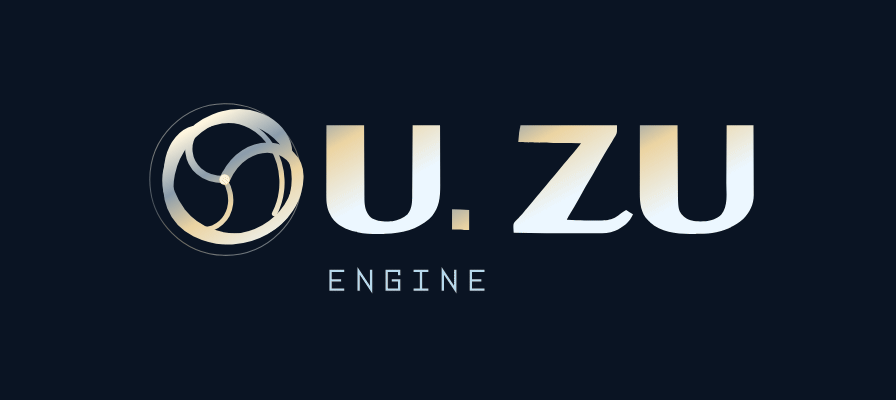

# U.ZU Engine identity

Based on the official U.ZU company identity, at the owner's request on
2026-11-17 (Japan time).



## Sources

- Header identity: <https://u-zu.co.jp/assets/uzu-identity.svg>
- Application icon: <https://u-zu.co.jp/assets/uzu-icon.svg>
- Original downloaded sources: `official-identity.svg`, `official-icon.svg`.
- `wordmark-paths.svg`: vector tracing of the wordmark PNG embedded in the
  official header SVG. Used to remove the embedded-image/mask dependency from
  engine SVGs. The circular mark's paths and metallic gradient come directly
  from the official identity.

Existing engine copyright, license, and upstream logo attribution files are
retained.

## Engine integration

- `main/app_icon.png`: runtime application/window icon, official icon variant.
- `main/splash.png`, `main/splash_editor.png`: static default engine/editor
  splash, official header identity plus an outlined ENGINE subtitle.
- `editor/icons/Logo.svg`, `GodotFile.svg`: separate wordmark and circular mark
  used by the About dialog. Existing internal icon identifiers are retained.
- `editor/icons/TitleBarLogo.svg`, `Godot.svg`, `GodotMonochrome.svg`: editor
  title-bar and small icon variants.
- `editor/icons/DefaultProjectIcon.svg`: the official icon for newly created
  projects. Existing projects' saved/custom icons are not overwritten.
- `misc/logo/` PNG/SVG files and `misc/dist/html/logo.svg`: distributed artwork.

The About dialog turns only the circular mark once in 2.4 seconds using
smoothstep easing. Text stays fixed. Processing stops after the turn and when
the dialog is hidden; reopening restarts the motion. Splash images stay static
and do not add startup delays. Game/project settings and compatibility names
are unchanged.

`generate_assets.py` does not regenerate native platform packaging files
(`.ico`, `.icns`, Apple Icon Composer layers), or overwrite existing games'
custom/project icons. Windows executable icons use the separate generator below.

Editor logo variants supply the official navy background so their light
metallic colors remain legible with light editor themes.

## Preview and regeneration

Open `preview.html` in a browser for replay/stop controls. Its initial animation
honors reduced-motion preferences and stops when the document is hidden. The
GIF repeats for viewing; the actual About animation runs once per opening.

```sh
# SVG exports and self-contained preview; Python standard library only.
python3 misc/logo/uzu/generate_assets.py

# Also export the PNGs using Playwright and /usr/bin/chromium.
python3 misc/logo/uzu/generate_assets.py --raster
```

The website is never changed or fetched by regeneration. The generator renders
the stored artwork; it does not need VTracer to run. VTracer 0.6.15 was used once
to produce the stored wordmark paths from the official embedded image.

## Actual editor smoke check

[Dark editor](editor-preview.png) · [Light editor](editor-preview-light.png)

With a graphical display, open the isolated `verify/` project in the new
editor. Its temporary verification plugin opens the actual About dialog,
samples rotation, checks that processing stops after the turn and when hidden,
and checks that reopening restarts it. It leaves the dialog open for inspection.

```sh
UZU_LOGO_REPORT=/tmp/uzu-logo-smoke.json UZU_LOGO_AUTOCLOSE=1 \
  bin/godot.linuxbsd.editor.x86_64 --editor --path misc/logo/uzu/verify
```

`UZU_LOGO_REPORT` defaults to `user://uzu-logo-smoke.json`. With
`UZU_LOGO_AUTOCLOSE=1`, the verification editor exits 20 seconds after writing
the result, with code 0 for a passing check or 1 for a failed check. Without
that flag it stays open. Set `UZU_LOGO_SCREENSHOT` to a PNG path to capture
the actual About viewport after the animation settles. Use an isolated editor
profile for automated runs.

## Windows executable icons (B-108)

The operating system can show an executable's embedded icon before the engine
sets its runtime window icon. Both `platform/windows/godot.ico` and
`godot_console.ico` therefore contain the official U.ZU application mark from
`official-icon.svg`. The internal filenames and resource identifiers stay the
same, including the export-template and console-wrapper resource files.

```sh
# Requires Pillow, Playwright and a Chromium executable.
# Convert only the stored official SVG; no website access or artwork changes.
python3 misc/logo/uzu/generate_windows_icons.py

# Verify every frame against a fresh SVG rendering without modifying assets.
python3 misc/logo/uzu/generate_windows_icons.py --check
# If Chromium is not on PATH: append --chromium /path/to/chromium
```

Each ICO contains RGBA frames at 16, 24, 32, 48, 64, 128 and 256 pixels. Both
executables use identical artwork. The generator renders each size directly,
preserving the SVG's transparency, and verifies all four Windows RC references.
PNG-compressed ICO frames are supported by the engine's Windows 10+ baseline.
The embedded default is also used by export templates; exported games' custom
icon settings still take precedence.

After rebuilding the Windows editor and its console wrapper, launch the actual
new binaries and confirm that the taskbar starts with U.ZU immediately, before
the runtime icon is set. Repeat for the console executable. This visual startup
check requires Windows and is separate from the cross-platform asset checks.
No new editor UI is introduced.

macOS audit: editor bundles copy `misc/dist/macos_tools.app`; both Info.plist
and Info_x86_64.plist reference `Contents/Resources/GodotLG.icns` and the
`GodotLG` asset name. The template bundle uses `Contents/Resources/icon.icns`.
These are separate stored assets, still containing upstream artwork; they do
not regenerate automatically from `official-icon.svg` or `misc/logo/icon.svg`.
Apple Icon Composer layers also remain separate. B-108 updates Windows assets
only; macOS packaging needs its own replacement and native startup verification.
